## Connect with me. 🤝

&nbsp;&nbsp;
&nbsp;&nbsp;
&nbsp;&nbsp;

🌐 Website &nbsp;·&nbsp; LinkedIn &nbsp;·&nbsp; YouTube &nbsp;·&nbsp; Email

## About Me. 😊

- 🎓 B.E. (Honours) in **Electrical & Electronics Engineering**, 2026 graduate.
- 🔌 Interested in **Embedded Systems, Electronics, IoT and R&D**.
- ⚙️ Exploring microcontrollers, hardware interfacing and electronic system design.
- 💻 Working with **C, Embedded C and Python**.
- 🐧 Currently learning **Linux and SQL**.
- 📊 Planning to explore **Power BI and Data Analytics**.
- 🤖 Interested in understanding **AI** and its applications across engineering and technology.
- 📄 Presented a research paper at **IC3MLA 2025**.
- 💡 Enjoy building projects, experimenting with new ideas and learning across technical domains.

## Languages and Tools. 🛠️

  

## Stats. 📊

 

 

### 💰 You can help me by donating

<!-- Proudly created with GPRM ( https://gprm.itsvg.in ) -->